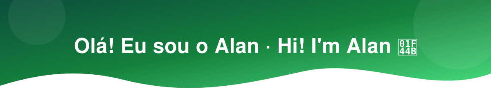

  
  

🇧🇷 Estudante de **Sistemas de Informação na Universidade de São Paulo (USP)**, interessado em engenharia de software, inteligência artificial e desenvolvimento de sistemas. Gosto de explorar problemas complexos, entender como as coisas funcionam e transformar ideias em soluções reais. Tenho interesse especial em sistemas distribuídos, integração de tecnologias, processamento de dados e aplicações de IA. Atualmente, divido meu tempo entre desenvolvimento de software, projetos independentes e pesquisa científica.

🇺🇸 I'm an **Information Systems student at the University of São Paulo (USP)**, interested in software engineering, artificial intelligence, and systems development. I enjoy exploring complex problems, understanding how things work, and turning ideas into practical solutions. My main interests include distributed systems, technology integration, data processing, and AI-powered applications. Currently, I split my time between software development, independent projects, and scientific research.

---

### 🔬 Atuação · Experience

- **C&P Engenharia e Automação**
  - 🇧🇷 Estagiário em desenvolvimento de software na plataforma TITAN®, trabalhando com integração de sistemas, processamento de dados, simulação e aplicações de inteligência artificial.
  - 🇺🇸 Software Development Intern working on TITAN®, a platform focused on system integration, data processing, simulation, and AI applications.
- **IPEN**
  - 🇧🇷 Iniciação Científica em digitalização de plantas nucleares, explorando digital twins, inteligência artificial e modernização de sistemas nucleares.
  - 🇺🇸 Undergraduate Researcher studying the digitalization of nuclear power plants, exploring digital twins, artificial intelligence, and nuclear systems modernization.

---

### 🛠️ Tech Stack

  

  
  
  
  
  

---

### 💡 Áreas de interesse · Areas of Interest

🇧🇷 Engenharia de Software · Desenvolvimento de Sistemas Web · Desenvolvimento de Jogos (GameDev) · Inteligência Artificial e LLMs · Sistemas Multiagentes · Engenharia de Dados · Sistemas Distribuídos · Digital Twins e Simulação · Automação Industrial

🇺🇸 Software Engineering · Web Systems Development · Game Development (GameDev) · Artificial Intelligence & LLMs · Multi-Agent Systems · Data Engineering · Distributed Systems · Digital Twins & Simulation · Industrial Automation

---

### 🚀 Projetos · Projects

🇧🇷 Aqui você encontra projetos acadêmicos, experimentais e independentes. Gosto de experimentar tecnologias, aprender continuamente e construir soluções que tenham utilidade além do código.

🇺🇸 This profile brings together academic, experimental, and independent projects. I enjoy exploring technologies, continuously learning, and building solutions that go beyond writing code.

---

### 📫 Contato · Get in touch

- **LinkedIn:** [linkedin.com/in/alan-moura-silva](https://linkedin.com/in/alan-moura-silva/)
- **GitHub:** [@Adamarac](https://github.com/Adamarac)
